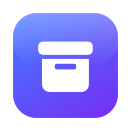
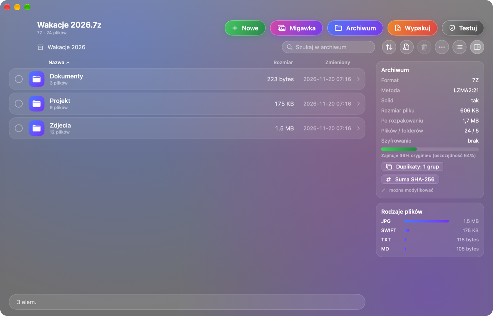
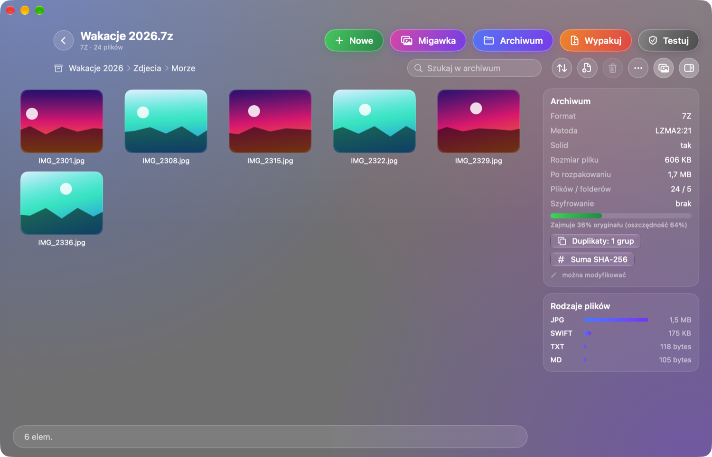
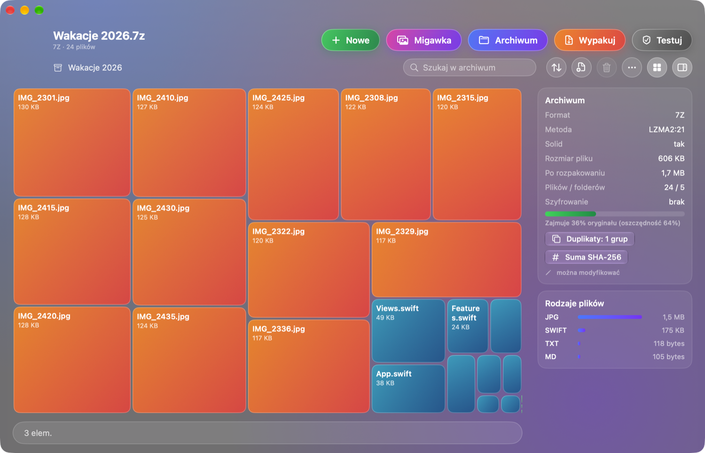
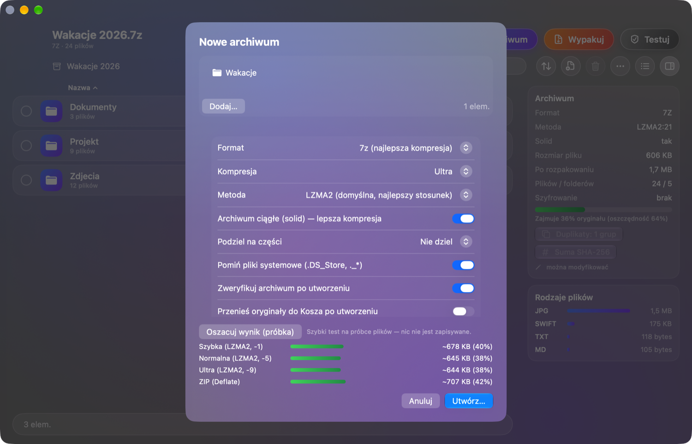
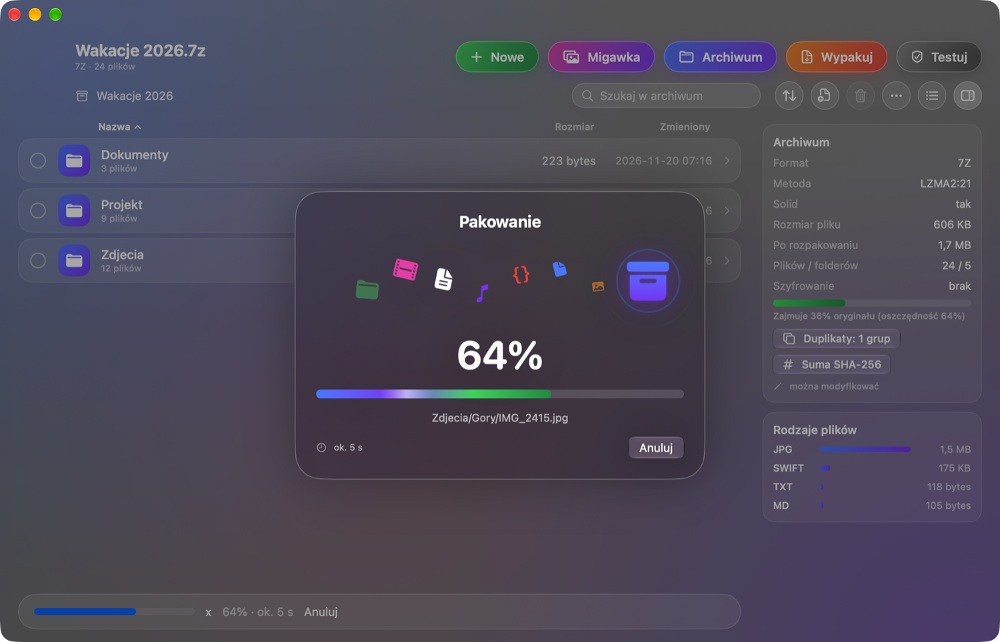
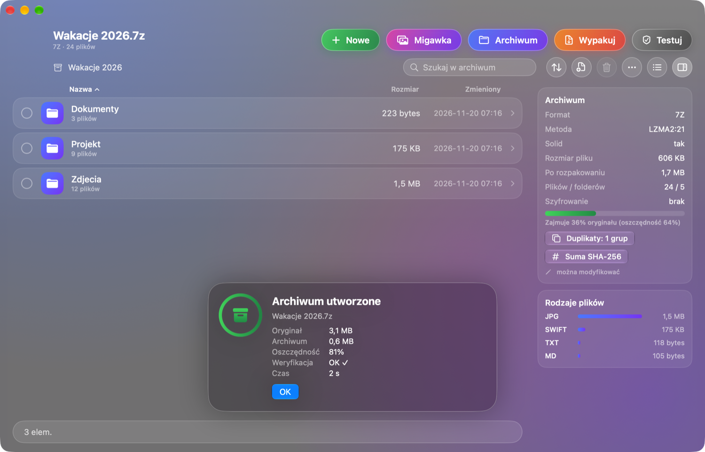
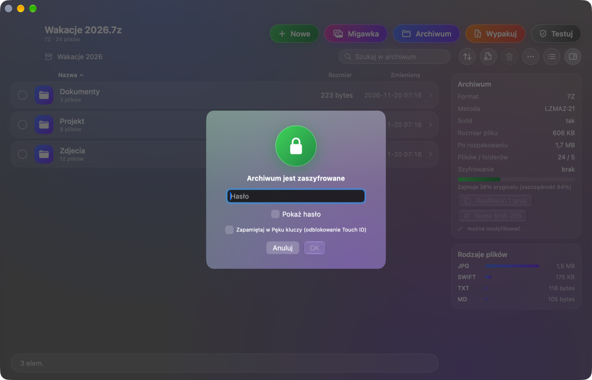
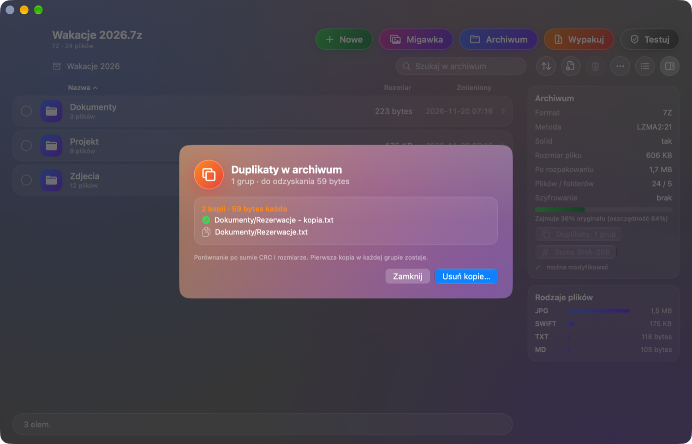

<div align="center">



# Archiwum

**Szybki, natywny menedżer archiwów dla macOS — z szyfrowaniem, dyskiem RAM i szklanym interfejsem.**
Odpowiedź na pytanie: „a dlaczego na Macu nie ma niczego tak dobrego jak 7-Zip na Windowsie?”




</div>

---

## Dlaczego Archiwum?

Systemowe narzędzie macOS otwiera ZIP-y i nic więcej. Programy z innych platform wyglądają obco i zostawiają pliki tymczasowe tam, gdzie nie powinny.
**Archiwum** jest napisane od zera w **Swift + SwiftUI**, ma wygląd z rodziny nowych aplikacji macOS (przezroczyste „szkło”, animacje, dopracowane detale)
i używa sprawdzonego silnika **7-Zip** — więc potrafi tyle, co 7-Zip, ale jest po prostu przyjemne w użyciu.

## Najważniejsze możliwości

| | |
|---|---|
| 📦 **Dziesiątki formatów** | 7z, ZIP, RAR (odczyt), TAR, GZ, BZ2, XZ, ISO, CAB, WIM, LZH, ZST i inne — otwieranie; **tworzenie**: 7z, ZIP, TAR.GZ/BZ2/XZ, TAR |
| 🔐 **Szyfrowanie AES-256** | Archiwa 7z (także z ukrytymi nazwami plików) i ZIP, generator haseł z miernikiem siły |
| 🧠 **Dysk RAM zamiast dysku** | Pliki otwierane z archiwum lądują na dysku w pamięci, który jest **zerowany i odmontowywany** po użyciu |
| 👁️ **Podgląd bez śladów** | Obrazy, PDF, tekst i wideo bez zapisu na SSD; miniatury powstają wyłącznie w pamięci |
| 🗜️ **Maksymalna kompresja** | Poziom „Ekstremalny” (słownik do 1 GB), PPMd, solid, podział na części i **szacunek wyniku** przed spakowaniem |
| 🧭 **Wygoda 7-Zip, wygląd macOS** | Lista, miniatury, **mapa rozmiarów (treemap)**, panel informacji, szukanie, sortowanie, skróty klawiszowe |
| 🖱️ **Integracja z Finderem** | Prawy klik → **Archiwizuj folder**, **Wypakuj tutaj**, przeciąganie plików z archiwum do Findera |

## Zobacz, jak wygląda

<table>
<tr>
<td width="50%"><br><sub><b>Ekran startowy</b> — upuść archiwum albo pliki do spakowania. Tło żyje: powoli dryfujące poświaty.</sub></td>
<td width="50%"><br><sub><b>Miniatury</b> zdjęć z archiwum — rozpakowywane tylko w pamięci, bez zapisu na dysk.</sub></td>
</tr>
<tr>
<td><br><sub><b>Mapa rozmiarów</b> — od razu widać, co zajmuje miejsce w archiwum.</sub></td>
<td><br><sub><b>Tworzenie</b> — metoda, słownik, szyfrowanie, podział na części i <i>szacunek wyniku z próbki</i>.</sub></td>
</tr>
<tr>
<td><br><sub><b>Animacja pakowania</b> — pliki wpadają do pudełka, widać bieżący plik, postęp i szacowany czas.</sub></td>
<td><br><sub><b>Karta wyniku</b> z konfetti, oszczędnością miejsca i automatyczną weryfikacją archiwum.</sub></td>
</tr>
<tr>
<td><br><sub><b>Szyfrowane archiwa</b> — hasło można zapamiętać w Pęku kluczy i odblokowywać Touch ID.</sub></td>
<td><br><sub><b>Duplikaty</b> — wykrywanie identycznych plików (CRC) i odzyskiwanie miejsca.</sub></td>
</tr>
</table>

## Funkcje szczegółowo

### Archiwa
- Otwieranie i **przeglądanie wszystkich popularnych formatów**, także `.tar.gz` / `.tar.xz` / `.tar.bz2` (strumieniowo, bez plików tymczasowych).
- Wypakowywanie całości lub zaznaczonych plików (zaznaczanie: kółka, ⌘/⇧ + klik, ⌘A), opcje podfolderu i zachowania przy istniejących plikach.
- **Dodawanie i usuwanie plików** w istniejących archiwach 7z/ZIP.
- **Test integralności**, **ratowanie danych** z uszkodzonych archiwów, **konwersja** między formatami (przez dysk RAM).
- **Wiele okien** — każde archiwum we własnym oknie; **przeciąganie plików z jednego archiwum do drugiego** (dodaj do archiwum albo utwórz nowe).
- **Wypakowywanie wsadowe** — upuść kilka archiwów naraz.
- **Porównywanie** archiwum z innym archiwum lub folderem, **szukanie w treści plików**, eksport listy do CSV.
- Sumy kontrolne **SHA-256** (plik `.sha256`) i **podpisy cyfrowe Ed25519** (`.sig`).

### Bezpieczeństwo i prywatność
- **Dysk RAM** na pliki otwierane z archiwum (`Otwórz`, odtwarzanie wideo, przeciąganie do Findera, szukanie w treści): oznaczony jako niewidoczny dla Spotlighta, **nadpisywany zerami** przed odmontowaniem.
- Brak „ostatnich dokumentów”, brak przywracania okien, brak zrzutów pamięci, blokada podpinania debuggera.
- **Automatyczna blokada hasła** po bezczynności (konfigurowalna).
- **Skaner ostrzeżeń**: bomby kompresji, ścieżki wychodzące poza folder docelowy (`../`), dowiązania symboliczne, programy wykonywalne, kontrola wolnego miejsca.
- **Kwarantanna**: pliki wypakowane z pobranego archiwum dziedziczą znacznik `com.apple.quarantine`.
- Opcjonalne zapamiętanie hasła w **Pęku kluczy** z odblokowaniem przez **Touch ID**.

### Interfejs
- Przezroczyste „szkło”, animowane tło, sprężyste przyciski, animacja pakowania i rozpakowywania, karta wyniku z konfetti, ikona w Docku z postępem.
- Widoki: lista, **miniatury**, **mapa rozmiarów**; panel informacji z rozkładem typów plików i stopniem kompresji.
- Skróty: `Spacja` podgląd · `Enter` otwórz · `⌘F` szukaj · `⌘I` panel · `⌘E` wypakuj · `⇧⌘T` testuj · `⇧⌘L` zablokuj.
- Redukcja ruchu i etykiety dostępności respektowane.

## Instalacja

1. Pobierz **`Archiwum-1.0.1.dmg`** z zakładki [Releases](../../releases) i przeciągnij **Archiwum** do **Programów** (lub `~/Applications`).
2. Aplikacja nie jest notaryzowana. Przy pierwszym uruchomieniu kliknij ją **prawym przyciskiem → Otwórz**, albo wykonaj:
   ```bash
   xattr -dr com.apple.quarantine /Applications/Archiwum.app
   ```
3. **Menu Findera** (Archiwizuj folder, Wypakuj tutaj): po instalacji w `Programy`/`~/Applications` wykonaj raz
   ```bash
   /System/Library/CoreServices/pbs -update
   ```
   i ewentualnie włącz pozycje w *Ustawienia systemu → Klawiatura → Skróty klawiszowe → Usługi*.

**Wymagania:** macOS 26 lub nowszy, Apple Silicon (arm64).

## Budowanie ze źródeł

Potrzebujesz Xcode Command Line Tools i silnika 7-Zip (`brew install sevenzip` udostępnia polecenie `7zz`).

```bash
git clone https://github.com/Carrot79PL/Archiwum.git
cd Archiwum
./build.sh        # buduje Archiwum.app (podpis ad-hoc, hardened runtime)
./install.sh      # instaluje w ~/Applications i rejestruje usługi Findera
./make_dmg.sh     # tworzy instalator DMG
```

### Testy

Aplikacja ma wbudowany test integracyjny uruchamiany bez interfejsu (tworzy archiwa we wszystkich formatach, sprawdza otwieranie,
szyfrowanie, podgląd, miniatury, dysk RAM, wypakowywanie, kwarantannę, podpisy, szukanie w treści, wsad i więcej):

```bash
Archiwum.app/Contents/MacOS/Archiwum --selftest /tmp/archiwum-test
```

## Architektura

```
Sources/
  App.swift        — stan aplikacji (Store), logika operacji, punkt wejścia
  Views.swift      — główne okno, lista, panel informacji, arkusze (tworzenie, wypakowanie, konwersja, wsad)
  Visuals.swift    — animacje pakowania, karta wyniku, mapa rozmiarów (treemap), ustawienia
  GlassUI.swift    — szklane tło, paleta, przyciski
  Engine.swift     — uruchamianie 7zz, parsowanie list, tworzenie, estymacja
  RamDisk.swift    — dysk RAM (hdiutil/newfs_hfs), zerowanie i odmontowanie
  Security.swift   — analiza archiwów, kwarantanna, Pęk kluczy + Touch ID, podpisy Ed25519, usługi Findera
  Features.swift   — porównywanie, szukanie w treści, miniatury, przeciąganie, ratowanie danych
  SelfTest.swift   — test integracyjny
```

Silnik kompresji (`7zz`) działa jako osobny proces; aplikacja jest wyłącznie warstwą interfejsu i bezpieczeństwa.

## 🤝 Współpraca z Migawką

Jeśli masz zainstalowaną **[Migawkę](https://github.com/Carrot79PL/Migawka)** (bezpieczną przeglądarkę zdjęć, filmów i archiwów), Archiwum potrafi się z nią zintegrować:

- w pasku narzędzi pojawia się przycisk **Migawka** — otwiera całe archiwum w Migawce (która rozpakowuje je na własny dysk RAM i obsługuje hasło),
- zaznaczenie **zdjęć lub filmów** i kliknięcie **Otwórz** przekazuje archiwum do Migawki, a pozostałe pliki (dokumenty, kod…) otwierają się w domyślnych aplikacjach z dysku RAM Archiwum,
- prawy klik na pliku → **Otwórz archiwum w Migawce**.

Bez Migawki wszystko działa tak samo — zdjęcia i filmy otwierają się wtedy z dysku RAM Archiwum.

## Uczciwie o ograniczeniach

- **Hasło jest przekazywane do silnika 7-Zip jako argument procesu** (`-p…`) — w trakcie operacji widzą je procesy tego samego użytkownika (np. `ps`). 7-Zip nie pozwala w tym trybie na inną drogę.
- **Dysk RAM wymaga wyłączenia App Sandbox** — aplikacja ma więc dostęp do plików jak zwykły program; zabezpieczenia to hardened runtime, brak sieci i ograniczenia opisane wyżej.
- Zerowanie pamięci przed odmontowaniem nie gwarantuje braku śladów w **pliku wymiany (swap)** — macOS domyślnie go szyfruje, ale to nie jest absolutna gwarancja. Zewnętrzne aplikacje, w których otwierasz pliki, mogą zapisać własne ślady.
- Niektóre RAR-y (np. z metodami spoza obsługi 7-Zip, błąd „Unsupported Method”) Archiwum rozpakowuje zapasowo przez zewnętrzny `unrar`, jeśli jest zainstalowany (`brew install unrar`) — wykrywa go samo.
- Aplikacja **nie jest notaryzowana** (ad-hoc podpis), działa na Apple Silicon i macOS 26+.
- Tryb jasny i wersja angielska nie są jeszcze dostępne.
- Migawka rozpakowuje całe archiwum (nie pojedyncze pliki) i prosi o hasło osobno.

## Licencje

Kod aplikacji: **MIT** (`LICENSE`). Silnik **7-Zip** (LGPL + unRAR restriction) jest dołączony jako osobny plik wykonywalny — szczegóły w [`NOTICE.md`](NOTICE.md).

---

<div align="center"><sub>Zrobione z miłością do porządnych narzędzi. Jeśli Archiwum Ci się przydaje — zostaw ⭐.</sub></div>
